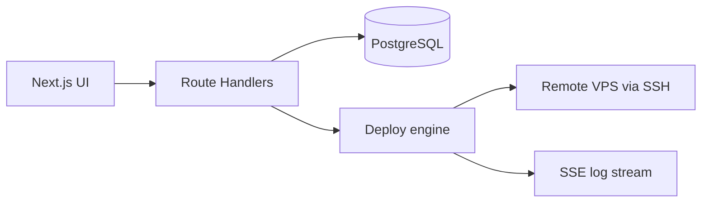

# DeployOps


**Fleet deploy console for static sites** — inventory VPS hosts over SSH, manage domains and reusable templates, then ship releases with a guided wizard and live logs.

Built as a portfolio / lab system that mirrors how an agency ops team would run many microsites from one panel.

## Why reviewers care

- End-to-end **ops product**, not a CRUD tutorial: encryption, RBAC, audit, SSE job logs, rollback
- Clear separation: UI (App Router) · API routes · deploy engine · Prisma data model
- Safe defaults for public demos: empty region list, example credentials only, no client data

## Features

| Area | What you get |
|------|----------------|
| **Servers** | SSH inventory, AES-256-GCM credential encryption, connection test, remote file browser |
| **Domains** | Web roots, presets, bulk import, deploy modes |
| **Regions** | Optional region tags for organizing fleets (empty by default) |
| **Templates** | ZIP site templates with in-browser tree, editor, sandboxed preview |
| **Content packs** | Reusable asset bundles scoped to a region or team group |
| **Entry files** | Per-region bootstrap HTML/PHP entrypoints (admin-managed) |
| **Deploy wizard** | Domain → region → template → pack → entry → run, with batch mode |
| **Observability** | Live SSE logs, job history, rollback, full audit trail |
| **Access** | Roles (`admin` / `team_lead` / `operator`), groups, per-asset visibility |

## Stack

`Next.js (App Router)` · `React 19` · `TypeScript` · `Tailwind` · `shadcn/ui` · `Prisma` · `PostgreSQL` · `Auth.js` · `node-ssh` · `SSE` · `vitest`

## Architecture



## Quick start

```bash
pnpm install
cp .env.example .env
# Generate secrets:
#   node -e "console.log(require('crypto').randomBytes(32).toString('base64'))"
# Set DEPLOYOPS_SECRET_KEY, NEXTAUTH_SECRET / AUTH_SECRET, SEED_ADMIN_*, POSTGRES_PASSWORD

pnpm docker:up          # Postgres on :5433
pnpm prisma migrate dev
pnpm db:seed
pnpm dev                # http://localhost:3000
```

### First steps in the UI

1. Create a group and invite operators (`/admin/*`)
2. Add regions if you need them (`/admin/geos`)
3. Upload templates / content packs
4. Import servers & domains
5. Run `/deploy` wizard and watch the live log

## Security highlights

- SSH passwords encrypted at rest (AES-256-GCM)
- bcrypt for user passwords · role checks on every mutating route
- Zip-bomb limits · rate-limited deploy endpoint · audit events with actor + IP

## Project layout

```
src/app/           # UI + API routes
src/components/    # UI kit
src/lib/           # prisma, crypto, ssh, zip, rbac, audit
src/server/deploy/ # engine, runner, rollback, SSE jobs
prisma/            # schema + migrations + seed
docker/            # local Postgres (+ optional pgAdmin)
```

## Scripts

```bash
pnpm test
pnpm typecheck
pnpm lint
pnpm build && pnpm start
```

## License

MIT — portfolio / demonstration use. No production secrets or client data included.
